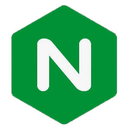

# Abdus Salam

I design, build and ship web applications end to end, from the database to the interface.
I care about reliability, clean design, and software that holds up in production.

  <b>Frontend</b>&emsp;

  <b>Backend</b>&emsp;&ensp;

  <b>Database</b>&emsp;

  <b>DevOps</b>&emsp;&ensp;&ensp;

  <b>Testing</b>&emsp;&ensp;

  Backend Developer · abdus.salam&#64;99technologies.com

